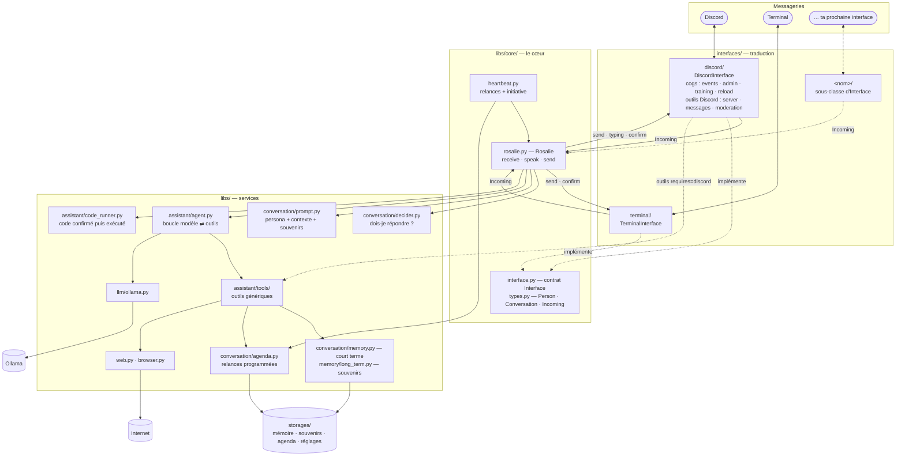
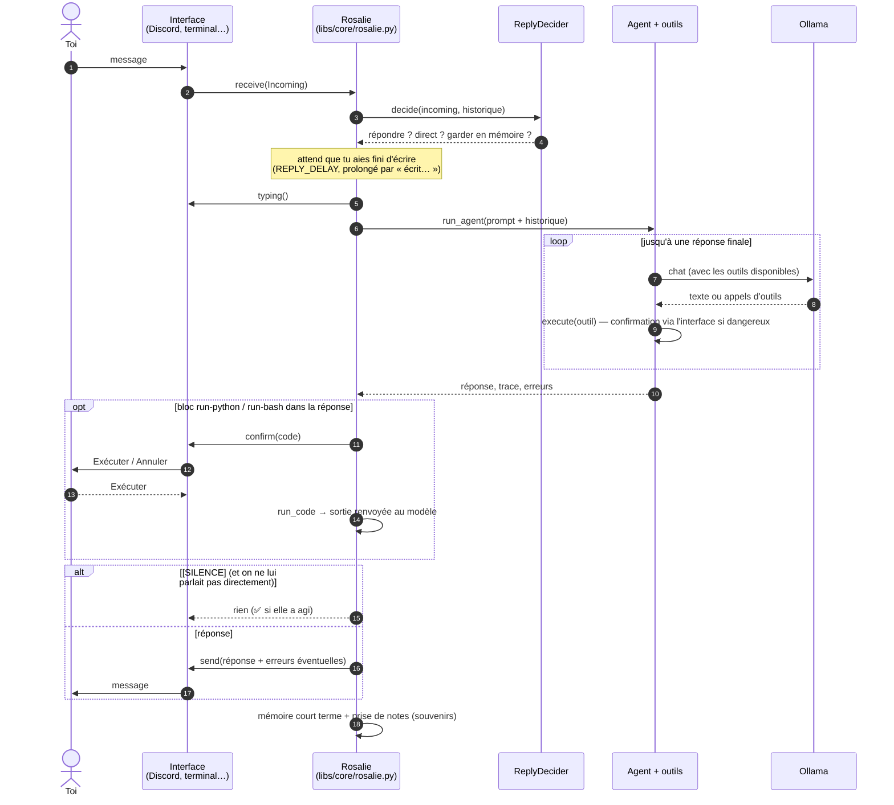

# Architecture

Rosalie est découpée en trois couches :

- **Les interfaces** (`interfaces/`) : par où on lui parle (Discord, terminal…). Elles ne font
  que traduire : message reçu → `Incoming`, réponse du cœur → message de la messagerie.
- **Le cœur** (`libs/core/`) : *qui* elle est et *comment* elle converse — décider de répondre,
  attendre que tu aies fini d'écrire, réfléchir avec ses outils, faire confirmer du code,
  se taire, revenir plus tard. Il ne connaît aucune messagerie, seulement le contrat
  [`Interface`](../libs/core/interface.py).
- **Les services** (`libs/`) : le modèle (Ollama), les mémoires, l'agenda, internet,
  l'exécution de code, les outils génériques.

## Vue d'ensemble



## Le trajet d'un message



Le **heartbeat** suit le même chemin sans message entrant : à chaque battement, il retrouve la
conversation d'une relance (ou la dernière conversation avec toi) par sa clé, et appelle
`speak()` avec une consigne (« c'est le moment de ta relance… », « moment de réflexion… »).

## Identifier une conversation ou une personne

Tout ce qui est persistant (historique, agenda, conversations dédiées, conversations actives)
utilise une **clé `interface:id`** : `discord:1139156385280573530`, `terminal:local`…
Le cœur ne manipule que ces clés et les types de [`libs/core/types.py`](../libs/core/types.py) :

| Type | Rôle |
|---|---|
| `Person` | qui parle : id natif, noms, `is_owner` (calculé par l'interface) |
| `Conversation` | où l'on parle : id natif, description (`place`), tête-à-tête ou non, objet natif |
| `Incoming` | un message reçu + les signaux calculés par l'interface (mention, réponse…) |
| `Sent` / `OutgoingFile` | un message envoyé / un fichier à envoyer |

Les fichiers d'avant la restructuration (ids Discord bruts) sont repris automatiquement.

## Les outils

- **Génériques** (`libs/assistant/tools/`) : `say`, relances, souvenirs, recherche web,
  lecture de pages, photos, météo. Ils marchent quelle que soit l'interface.
- **Propres à une interface** (`interfaces/<nom>/tools/`) : déclarés avec
  `@tool(..., requires="<nom>")`. Ils ne sont proposés au modèle que si l'interface tourne —
  mais depuis **n'importe quelle** interface : depuis le terminal, elle peut écrire sur Discord.

## Arborescence

```
bot.py                         point d'entrée : python bot.py <commande>
commands/                      rosalie (défaut) · chat · settings · users · web · pull · test
interfaces/
  __init__.py                  registre des interfaces (python bot.py : toutes sauf le terminal)
  discord/
    __init__.py                DiscordInterface : Discord ⇄ cœur
    cogs/                      events (messages, « écrit… ») · admin (/rosalie) · training (⭐) · reload
    tools/                     outils Discord : server · messages · moderation (+ helpers)
    resolver.py                « Le bunker » / #salon / @membre → objets Discord
    confirm.py                 boutons Confirmer/Annuler, Exécuter/Annuler
    utils.py                   description d'un salon, texte lisible d'un message
  terminal/__init__.py         TerminalInterface : discuter dans la console
  web/__init__.py              WebInterface : le lien entre le site et le cœur (un compte = une conversation)
libs/
  core/                        le cœur : rosalie.py · heartbeat.py · interface.py · types.py · text.py
  assistant/                   agent.py · code_runner.py · tools/ (génériques)
  conversation/                decider · memory · prompt · agenda · initiative
  memory/                      long_term (SQLite + embeddings) · extractor (prise de notes)
  llm/                         ollama · persona
  web.py · browser.py          internet, navigateur virtuel
  db/                          Database : SQLite + ORM SQLAlchemy, migrations Alembic appliquées à l'ouverture
  config/                      Config · schema (chaque réglage) · models (ORM) · store (config.sqlite3 + storages/personas/*.md)
  models/                      modèles de données partagés (ORM) : user · accounts · chat · config
  webui/                       backend MVC du site : views/ · controllers/ · api/v1.py · server.py
  settings.py · log.py
personas/rosalie.md            sa personnalité par défaut (intégrée, lecture seule)
migrations/                    Alembic : config/ (config.sqlite3) · main/ (rosalie.sqlite3)
webui/                         le site : React + React Router + Tailwind (Vite) → webui/dist
finetune/                      fine-tuning, séparé du bot
tests/                         python bot.py test
docs/                          cette documentation
```
