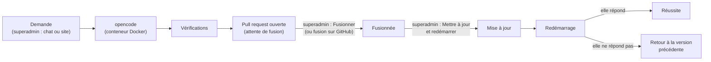

# Évolution du code

Rosalie peut faire évoluer **son propre code** : son modèle principal délègue la modification à
l'agent de programmation **[opencode](https://opencode.ai)**, qui travaille avec le **modèle de
code** dans un **conteneur Docker** (un clone isolé du dépôt y est monté) et propose le résultat
dans une **pull request**. Rien n'est fusionné ni appliqué tout seul : la
fusion, puis la mise à jour et le redémarrage, sont des actions explicites d'un **superadmin**.



## Quand elle s'en sert

Le modèle principal a l'outil `request_code_change` (et `code_changes` pour le suivi). Il s'en
sert quand son code doit changer :

- une **faille de sécurité** repérée ;
- une **fonctionnalité** proposée par un superadmin ;
- une demande **impossible avec ses capacités actuelles** ;
- un **bug** ou un problème de fiabilité.

Il transmet au modèle de code un dossier complet — titre, raison, **objectif**, **contexte**,
**contraintes**, **critères de réussite** — car le modèle de code ne voit pas la conversation.
Il n'y a **pas de confirmation** au lancement : le garde-fou est la pull request, relue avant
toute fusion. On peut aussi remplir ce dossier soi-même : site → menu → **Évolution du code** →
*Demander une modification*.

## Configuration

Tout est dans les réglages (site → Réglages, ou `python bot.py settings`) ; aucun secret dans le
code.

| Réglage | Onglet | Rôle |
|---|---|---|
| `evolve` | Évolution du code | active la fonctionnalité (désactivée par défaut) |
| `evolve_repo` | Évolution du code | dépôt GitHub `propriétaire/dépôt` (défaut : `EthannSchneider/Rosalie`) |
| `evolve_base_branch` | Évolution du code | branche de référence (défaut : `main`) |
| `github_token` | Évolution du code | jeton GitHub (secret, jamais renvoyé au navigateur) |
| `evolve_check_timeout` | Évolution du code | durée max de chaque vérification |
| `evolve_image` | Évolution du code | image du conteneur de travail (défaut : `rosalie-evolve:latest`, construite au premier besoin) |
| `evolve_timeout` | Évolution du code | durée max du travail d'opencode |
| `containers` | Conteneurs | **obligatoire** : opencode travaille dans un conteneur Docker ([Conteneurs](conteneurs.md)) ; `containers_network` doit rester sur oui |
| `code_model` | Modèles | le modèle de code utilisé par opencode, `fournisseur:nom` (vide = le modèle principal) |

Le fournisseur du modèle de code doit être activé dans l'onglet **Providers** (avec sa clé API) :
on peut garder un modèle principal local (Ollama) et confier le code à un modèle distant.

```bash
python bot.py settings set providers ollama,anthropic
python bot.py settings set anthropic_api_key          # demandé sans écho
python bot.py settings set code_model anthropic:claude-sonnet-5-5
python bot.py settings set github_token               # demandé sans écho
python bot.py settings set containers oui             # Docker doit être installé et lancé
python bot.py settings set evolve oui
```

### Jeton GitHub : permissions nécessaires

Crée un **fine-grained personal access token** (GitHub → Settings → Developer settings), limité
**au seul dépôt** de Rosalie, avec :

| Permission du dépôt | Accès | Pour |
|---|---|---|
| Contents | Read and write | cloner, pousser la branche de travail ; fusionner |
| Pull requests | Read and write | ouvrir la pull request, lire son état, la fusionner |
| Metadata | Read-only | (ajoutée d'office par GitHub) |

Rien d'autre : pas d'« Administration », pas de « Workflows » (le modèle de code ne peut de toute
façon pas modifier `.github/`). **Protège la branche de référence** sur GitHub (Settings →
Branches / Rulesets : *Require a pull request before merging*) : même avec ce jeton, plus
personne ne peut alors y pousser directement. Si tu ne veux pas que Rosalie puisse fusionner,
exige en plus une approbation (*Require approvals*) : le bouton *Fusionner* du site sera refusé
par GitHub et la fusion se fera sur GitHub.

## Qui a le droit

La permission **`evolve`** couvre tout : lancer une modification, fusionner, mettre à jour et
redémarrer. Elle est **réservée au rôle superadmin** : on ne peut la donner à aucun autre rôle
(ni sur le site, ni en ligne de commande, ni par les anciens `OWNER_IDS`). Elle est vérifiée
**côté serveur** à chaque fois :

- l'outil `request_code_change` n'est proposé au modèle, et exécuté, que si la personne qui
  parle a cette permission (sans confirmation) ;
- les routes `/api/v1/evolution…` exigent cette permission ;
- un message d'un autre utilisateur, une page web ou un fichier lu ne sont jamais des ordres :
  ils ne peuvent ni lancer une modification, ni fusionner, ni redémarrer.

Au terminal (`python bot.py chat`), c'est ta machine : tu as tous les droits.

## Ce qui se passe

1. **Clone** du dépôt dans un dossier temporaire, hors du dossier de Rosalie, supprimé à la fin.
2. **Branche dédiée** `rosalie/evolve-<n>-<titre>` créée depuis la branche de référence à jour.
3. **Conteneur de travail** `rosalie-evolve-<n>` (supprimé à la fin), où le clone est monté sur
   `/workspace`.
4. **opencode** y fait tout le travail — lire le dépôt (`AGENTS.md` compris), modifier, lancer
   les tests — avec un shell complet : il peut lancer ce qu'il veut (`pip install`, `npm`,
   `curl`, un test ciblé…). Rosalie ne lit pas le dépôt elle-même : elle suit seulement
   l'avancement (dernière ligne affichée par opencode, visible sur la page *Évolution du code*).
5. **Vérifications finales**, dans le conteneur : `python -m compileall`, `python bot.py test`,
   et la construction du site si `webui/` a changé, sur l'état exact qui sera poussé.
6. **Commit, push de la branche, pull request** — faits par l'hôte, pas par le conteneur.

### Le conteneur

- le code modifié n'est **jamais exécuté sur la machine** de Rosalie : opencode et les
  vérifications tournent dans le conteneur ;
- le dossier **`.git` du clone est caché** dans le conteneur (recouvert par un dossier vide) :
  rien de ce qui y tourne ne peut toucher à la configuration ou aux hooks de git, que l'hôte
  utilise ensuite pour le commit et le push. Le **jeton GitHub n'entre jamais** dans le conteneur ;
- si opencode a modifié un chemin protégé (`.github`, `storages`, `.env`), la modification est
  **annulée** avant le commit, et c'est écrit dans les risques de la pull request.

L'image par défaut (`deploy/docker/evolve.Dockerfile` : Python et les dépendances de Rosalie,
Node, git, opencode) est construite toute seule au premier lancement (quelques minutes).
Reconstruis-la quand `requirements.txt` change :
`docker build -t rosalie-evolve:latest -f deploy/docker/evolve.Dockerfile .`

### Redémarrer Rosalie pendant le travail

opencode tourne **en détaché** dans son conteneur : si Rosalie s'arrête ou redémarre pendant
qu'il travaille, il **continue**. Au démarrage, Rosalie retrouve le conteneur et le clone, et
**reprend le suivi** là où il en était (événement « Reprise après le redémarrage » dans le
journal), jusqu'à la pull request. La durée max (`evolve_timeout`) est comptée dans le conteneur,
redémarrage ou pas.

L'opération n'est marquée en échec au redémarrage que si le travail est vraiment perdu :
conteneur arrêté ou supprimé (redémarrage de la machine ou de Docker), ou clone disparu. Un
arrêt de Rosalie *avant* le lancement d'opencode (clone, démarrage du conteneur) ou *après*
(vérifications finales, push) interrompt l'opération comme avant, sauf si le conteneur est encore
là : les étapes finales sont alors rejouées.

### Le modèle

opencode utilise le `code_model` des réglages :

- **Ollama** : il le joint sur la machine par `host.docker.internal`. Sous Linux, Ollama doit
  écouter ailleurs que sur `127.0.0.1` seulement (`OLLAMA_HOST=0.0.0.0`) ; et comme opencode
  ne règle pas la taille du contexte, monte `OLLAMA_CONTEXT_LENGTH` côté serveur (32 000 ou
  plus). Un petit modèle local (8B) s'en sort mal comme agent de code sur un dépôt de cette
  taille : préfère un modèle de code plus gros, ou distant ;
- **OpenAI, Anthropic, Gemini** : la **clé API du fournisseur est donnée au conteneur** (c'est
  le seul secret qui y entre). Un agent trompé par un contenu lu pourrait la divulguer : utilise
  une clé dédiée, avec un plafond de dépense.

opencode écrit son compte rendu (titre, résumé, risques) dans un fichier hors du dépôt ; s'il ne
le fait pas, la pull request reprend le titre de la demande et la fin de sa sortie.

La pull request explique **pourquoi** (raison, demandeur, objectif, contexte), **ce qui a été
modifié** (résumé, fichiers), **les vérifications** (résultat de chacune) et **les risques ou
limites**. Si une vérification échoue, c'est écrit en tête, la sortie est jointe, la PR est
ouverte en brouillon et le bouton *Fusionner* du site est refusé (à toi de trancher sur GitHub).

Garde-fous :

- le modèle de code n'a de shell que dans son conteneur : rien ne tourne sur l'hôte ;
- il ne peut modifier ni `.git` (caché), ni `.github`, ni `.env`, ni `storages` (annulé) ;
- jamais de push sur la branche de référence, jamais de push forcé, jamais de fusion automatique ;
- si opencode échoue ou dépasse `evolve_timeout`, ne modifie rien, ou si la modification contient un secret des
  réglages : rien n'est poussé, l'opération est en échec ;
- le jeton passe à git par l'environnement (ni ligne de commande, ni adresse du dépôt) ; les
  secrets des réglages sont masqués dans les messages, les journaux, l'historique et la PR ;
- une seule modification à la fois, et aucune pendant une mise à jour.

⚠️ Le conteneur a accès au réseau (opencode doit joindre son modèle, installer des paquets) :
il peut atteindre internet et ton réseau local. Relis chaque pull request.

## Fusion

La pull request se relit sur GitHub (lien sur la page *Évolution du code* et dans le message de
Rosalie). Ensuite, soit tu la fusionnes sur GitHub (la page le détecte), soit un superadmin
clique sur **Fusionner** (fusion « squash », seulement si la branche n'a pas bougé depuis le
commit de Rosalie et que les vérifications ont réussi).

## Mise à jour et redémarrage

Une fois la pull request fusionnée, la page propose **Mettre à jour et redémarrer**. Cette action
est exécutée par le **superviseur**, un processus indépendant qui reste en vie pendant que
Rosalie redémarre. Il faut donc lancer Rosalie avec :

```bash
python bot.py supervise      # à la place de python bot.py
```

Le superviseur lance Rosalie (`python bot.py rosalie`), la relance si elle tombe, et surveille
les demandes de mise à jour. Il n'utilise que la bibliothèque standard et git, sans charger le
reste du code : une mise à jour cassée ne peut pas le casser. Sans lui, le bouton est désactivé.

Exemple de service systemd :

```ini
[Service]
WorkingDirectory=/opt/rosalie
ExecStart=/opt/rosalie/.venv/bin/python bot.py supervise
Restart=always
```

Ce que fait une mise à jour :

1. **Vérifie** sur GitHub que la pull request est fusionnée et que le commit demandé est bien
   son commit de fusion, puis que la branche de référence le contient. Refuse si l'installation
   a des modifications locales non commitées ou a divergé (rien n'est alors touché, Rosalie
   n'est pas arrêtée).
2. **Arrête** Rosalie proprement (comme un Ctrl+C : interfaces et bases fermées) et **sauvegarde** ses bases SQLite (`storages/evolve/backup/`).
3. **Déploie** exactement le commit de fusion (fast-forward) et **enregistre** la version
   appliquée et la précédente (historique de l'opération, `storages/evolve/supervisor.json`).
4. **Prépare** : `pip install -r requirements.txt` si les dépendances ont changé, reconstruction
   du site si `webui/` a changé ; les migrations de base s'appliquent au démarrage.
5. **Redémarre** Rosalie et **vérifie** qu'elle fonctionne : `GET /api/v1/health` doit répondre
   et le processus rester en vie.
6. En cas d'échec : **retour à la version précédente** (code, dépendances, site, bases
   restaurées), redémarrage, et l'opération passe en « mise à jour en échec » avec la raison ;
   on peut réessayer.

Limites à connaître :

- **Docker** : le code de l'image n'est pas un dépôt git et n'appartient pas à l'utilisateur du
  conteneur ; la mise à jour d'ici n'y est pas possible. Reconstruis l'image après la fusion
  (`docker compose -f deploy/docker/compose.yml up -d --build`). Tout le reste (demande, pull
  request, fusion) fonctionne : git est installé dans l'image.
- Le superviseur lui-même n'est remplacé par sa nouvelle version qu'à son propre redémarrage.
- Si une nouvelle version de Playwright est installée, son navigateur n'est pas retéléchargé
  automatiquement (`playwright install chromium`).
- Si `webui/` a changé et que `npm` est absent, le site reste dans sa version déjà construite
  (signalé dans l'historique).

## Suivi

Page **Évolution du code** du site (menu du compte → Administration) : pour chaque opération,
les étapes (analyse, modification, tests, pull request, fusion, mise à jour, redémarrage,
terminé ou échec), l'activité en cours, le lien de la pull request, le résultat des
vérifications, les versions (commits) et le journal daté avec l'auteur de chaque action. La page
se met à jour toute seule, y compris pendant le redémarrage.

Rosalie prévient aussi dans la conversation d'où vient la demande : pull request ouverte, échec,
mise à jour réussie ou annulée. L'historique est gardé dans `storages/rosalie.sqlite3` (table
`evolutions`).

## Code

| Fichier | Rôle |
|---|---|
| `libs/evolve/service.py` | `Evolver` : orchestration, fusion, demande de mise à jour, suivi |
| `libs/evolve/workspace.py` | clone isolé, git, vérifications |
| `libs/evolve/sandbox.py` | conteneur de travail `rosalie-evolve-<n>` |
| `libs/evolve/opencode.py` | opencode en détaché dans le conteneur, suivi, compte rendu |
| `deploy/docker/evolve.Dockerfile` | image du conteneur de travail |
| `libs/evolve/github.py` | API GitHub (pull requests) |
| `libs/supervisor.py` · `commands/supervise.py` | le superviseur |
| `libs/models/evolution.py` | historique des opérations (migration `0006`) |
| `libs/assistant/tools/evolve.py` | outils `request_code_change`, `code_changes` |
| `libs/webui/controllers/evolution.py` · `webui/src/pages/evolution/` | API et page du site |
